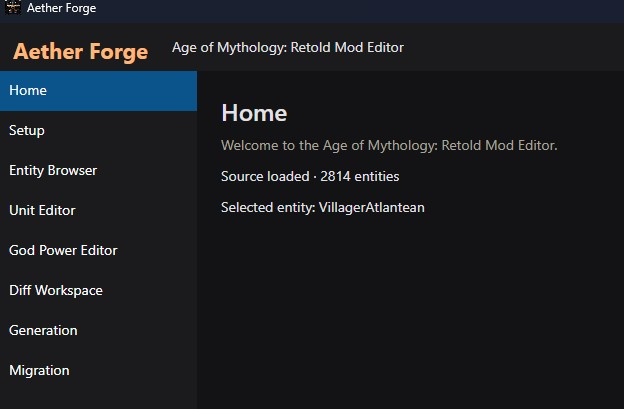
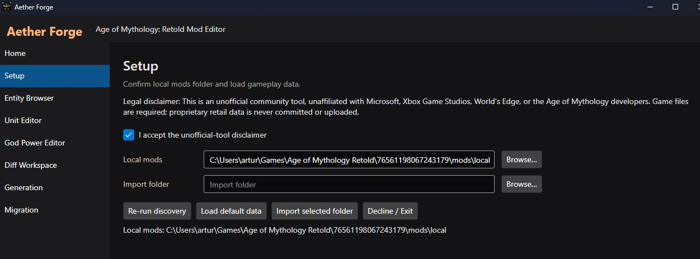
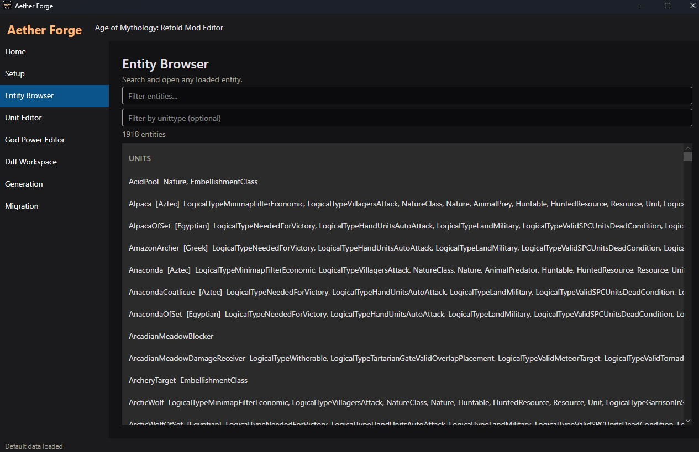
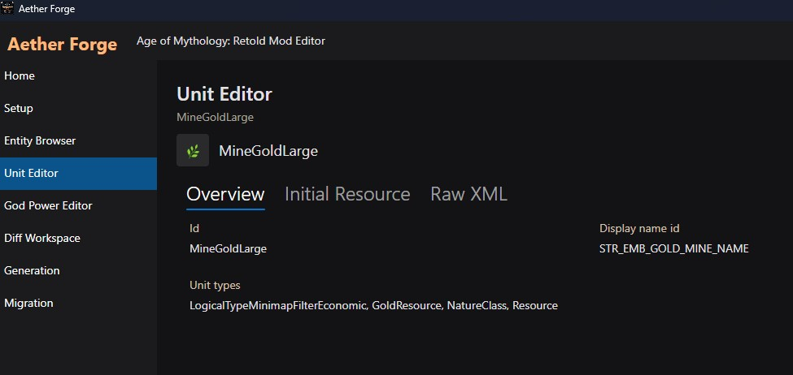
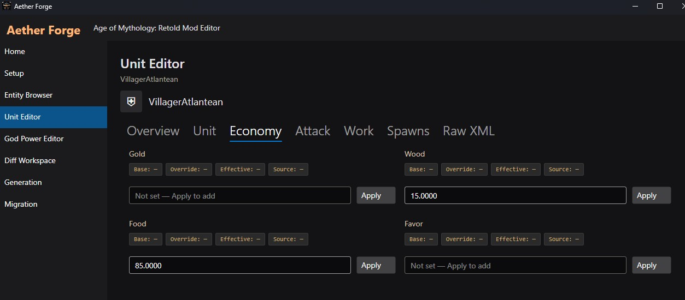

# Aether Forge

**Local mod editor for [Age of Mythology: Retold](https://www.ageofempires.com/games/age-of-mythology-retold/)**

Aether Forge is an API-first desktop tool for reading, editing, and shipping **additive gameplay mods**. Change units, buildings, and related data through a schema-driven UI — without overwriting retail files and without memory or multiplayer manipulation.

The app produces valid Retold local mods (`proto_mods.xml` with `mergeMode="replace"`) and can install them directly into your local mods folder.

<p align="center">
  
</p>

---

## Features

- **Entity Browser** — searchable, grouped overview of units, buildings, and other entities
- **Schema-driven editor** — tabs for Stats, Armor (%), Costs, Attack, Work, and more; only existing values are editable
- **Lossless XML** — unknown fields are preserved; diffs stay minimal and additive
- **Mod generation** — output as `ModName/game/data/gameplay/proto_mods.xml`
- **Generate + Install** — writes under `%USERPROFILE%\Games\Age of Mythology Retold\<SteamID64>\mods\local`
- **Auto-discovery** — detects the local mods path on startup (Steam-account dependent)
- **Embedded gameplay pack** — built from a local extract or synthetic fixtures; retail XML is **not** committed
- **API-first** — the Avalonia GUI talks only to the local REST API (loopback + ephemeral token)
- **Standalone backend** — optional API-only binary (`Backend+API.exe`) for external clients / automation

---

## Screenshots

### Home


### Setup

Configure local mods and optional import folder. Auto-discovery runs on startup.



### Entity Browser

Search and browse entities by group. Double-click or press Enter to open the editor.



### Unit Editor

Schema-driven tabs for stats, armor, costs, attack, and work.



### Unit Editor — Villager example

Editing a villager with live fields from the gameplay pack.



---

## Workflow

```text
Setup  →  Entity Browser  →  Unit/Building Editor  →  Generation  →  Local Mod
```

1. Optionally import your own gameplay folder (otherwise the embedded pack is used)
2. Search for an entity and open it with double-click / Enter
3. Adjust values (only changed leaves end up in the mod)
4. Choose a mod name → **Generate** or **Generate + Install**

---

## Requirements

| | |
|---|---|
| OS | Windows 10/11 (x64) |
| Runtime | Self-contained release: **no** separate .NET install required |
| Development | [.NET 10 SDK](https://dotnet.microsoft.com/download) |
| Game | Age of Mythology: Retold (for local mod install) |

---

## Quick start (release binaries)

From the repo root:

```powershell
.\build\publish-release.ps1
```

Output in `release\`:

| File | Purpose |
|------|---------|
| `GUI.exe` | Desktop app (recommended) — starts the embedded local API |
| `Backend+API.exe` | REST API / backend only |

Details: [`build/README.md`](build/README.md)

> **Note:** `release/` and the embedded pack are gitignored. The pack is produced at build time from `aomr_extract/original` (if present) or `fixtures/synthetic`.

---

## Development

```powershell
# Build
dotnet build AomrModEditor.sln

# Tests
dotnet test AomrModEditor.sln

# Run GUI
dotnet run --project src/AomrModEditor.App

# Run API only
dotnet run --project src/AomrModEditor.Api
```

More notes: [`docs/SETUP.md`](docs/SETUP.md)

### Embedded gameplay pack

When building the app:

1. If `aomr_extract/original/gameplay/proto.xml` exists → pack from that extract
2. Otherwise → synthetic fixtures under `fixtures/synthetic`

The pack (`EmbeddedGameplayPack.json.gz`) is **not** versioned — see `.gitignore`.

---

## Architecture

```text
┌─────────────────┐     REST (loopback)     ┌──────────────────┐
│  Avalonia GUI   │ ◄─────────────────────► │  ASP.NET Core    │
│  (App)          │   typed API client      │  API             │
└─────────────────┘                         └────────┬─────────┘
                                                     │
                    ┌────────────────────────────────┼────────────────┐
                    ▼                                ▼                ▼
             Application                    GameData / XML      ModGeneration
             (Use Cases)                    Persistence         (additive mods)
```

| Project | Role |
|---------|------|
| `AomrModEditor.App` | Avalonia desktop UI |
| `AomrModEditor.Api` | REST API (also embedded) |
| `AomrModEditor.Api.Client` | Typed HTTP client |
| `AomrModEditor.Api.Contracts` | DTOs / contracts |
| `AomrModEditor.Application` | Use cases, schema, classification |
| `AomrModEditor.Domain` | Domain model |
| `AomrModEditor.GameData` | Installation discovery, import |
| `AomrModEditor.ModGeneration` | Diff → `proto_mods.xml`, installer |
| `AomrModEditor.Persistence` | SQLite / local state |
| `AomrModEditor.Cli` | Command line |

Stack: **C# / .NET 10**, ASP.NET Core, Avalonia 11, SQLite, System.Xml.Linq, xUnit.

---

## Mod output

Example layout:

```text
MyCoolMod/
  game/
    data/
      gameplay/
        proto_mods.xml
```

Changed XML leaves get `mergeMode="replace"`, matching common Retold local mods. Only diffs are written — no full replace of base data.

---

## What this tool does **not** do

- No manipulation of running processes, memory, or anti-cheat
- No interference with multiplayer traffic or executables
- No bundling / committing of proprietary retail gameplay XML
- Not a “cheat injector” — editor + additive mod packages only

---

## Before pushing to GitHub

**Do not commit:**

- `aomr_extract/original/` — extracted retail gameplay data
- `src/.../EmbeddedGameplayPack.json.gz` — derived from retail / local extract
- `release/` — local publish output
- `bin/`, `obj/`, `.vs/`, `__pycache__/`

Research markdown under `aomr_extract/*.md` and synthetic fixtures are intended for the repo; original XML extracts stay local.

---

## License & game content

This project is released under the [MIT License](LICENSE).

This repository does **not** include official Age of Mythology content from Microsoft / World's Edge / Xbox Game Studios.

You need a legal copy of AoM: Retold to:

- extract gameplay data for a full pack, and
- install mods into the local mods folder and test in-game.

“Age of Mythology” and related trademarks belong to their respective owners. This project is an **unofficial fan / community tool**.

---

## Contributing

1. Fork / branch
2. Keep `dotnet test AomrModEditor.sln` green
3. Do not check in retail XMLs or generated pack blobs
4. Open a PR with a short description of the change

CI: [`.github/workflows/ci.yml`](.github/workflows/ci.yml) (`dotnet test` on `windows-latest`).

---

## Documentation in this repo

| Path | Contents |
|------|----------|
| [`docs/SETUP.md`](docs/SETUP.md) | Setup & safe workflow |
| [`docs/images/`](docs/images/) | Screenshots |
| [`build/README.md`](build/README.md) | Release publish |
| [`fixtures/synthetic/`](fixtures/synthetic/) | Synthetic test data |

---

## Credits

Built for the AoM: Retold modding community — API-first, local-first, additive mods first.
